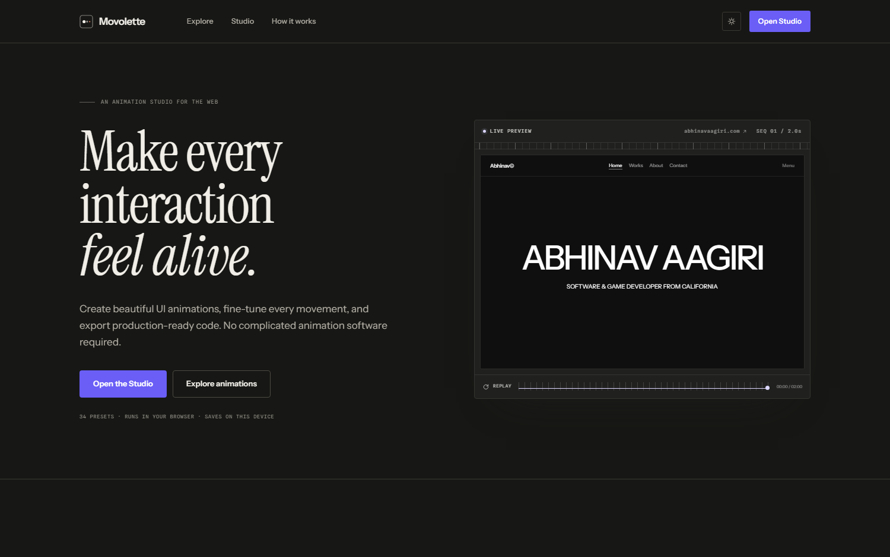
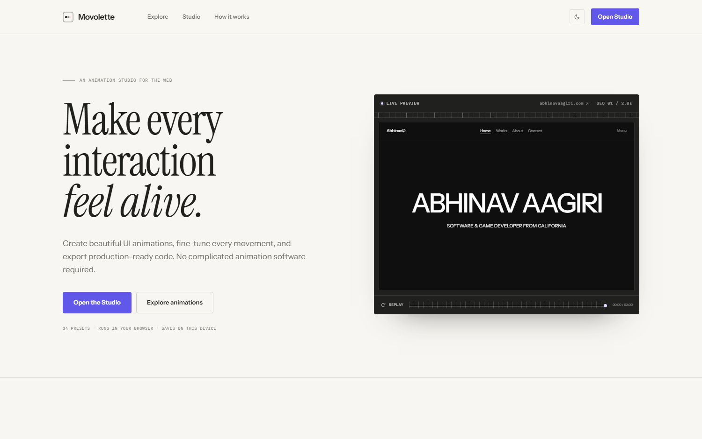
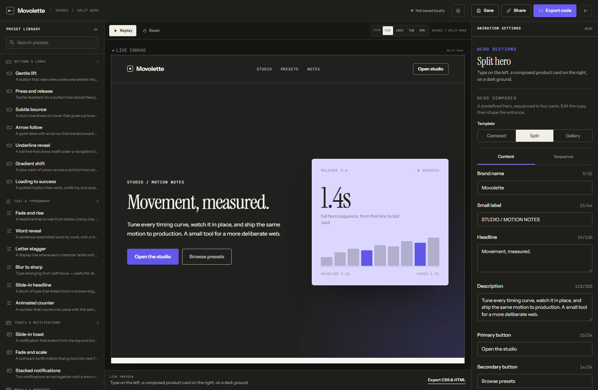

# Movolette

A browser-based studio for interface motion. Pick a preset, tune its timing, easing, and travel on a live canvas, then copy the HTML, CSS, and JavaScript into a real project. Every animation runs client-side, no account, backend, or build step needed to use it.

## Visuals

**Landing page — dark (default)**

**Landing page — light**

**Studio — hero composer**

